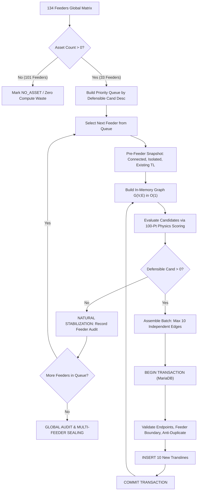

# TRANSLINE MULTI-FEEDER COMPLETION ENGINE v2 ARCHITECTURE
**System**: SIDAK TEJO AI Grid Intelligence Fabric  
**Subsystem**: Multi-Feeder Network Completion & Topology Engine v2  
**Target Scope**: 134 Medium-Voltage Feeders (20 kV SUTM) across 3 ULPs  
**Status**: ARCHITECTURE APPROVED (PHASE A + DRY-RUN READY)  

---

## 1. Executive Architecture Overview

Program **Network Completion Engine v2** menggantikan alur kerja manual iterative single-feeder dengan arsitektur **Automated Priority-Queue Batch Orchestrator**. 

Engine beroperasi dengan prinsip:
1. **Physics-First Topology**: Jarak rentang fisik (span $\le 85\text{ m}$), kelurusan bearing, dan kontinuitas seksi memegang otoritas primer di atas nomor urut tiang surveyor.
2. **Deterministic Hard Gates**: Tidak ada penyambungan buta hanya karena dua tiang berdekatan (*proximity is never sufficient on its own*).
3. **Atomic Transactional Batches**: Maksimal **10 transline baru per transaksi**. Kegagalan pada 1 kandidat memicu *rollback* 100% pada batch tersebut.
4. **Immediate In-Memory Graph Re-indexing**: Begitu batch committed, struktur graf $G(V,E)$ dimuat ulang dalam memori secara $O(1)$, derajat simpul dihitung ulang, dan kandidat baru dievaluasi berdasarkan topologi riil terbaru.
5. **Natural Stabilization Over Artificial 100%**: Engine berhenti secara alami ketika kandidat defensibel habis (`AUTO_DEFENSIBLE = 0`). Tiang ujung yang terpisah $> 85\text{ m}$ tetap dipertahankan terisolasi.
6. **Domain Boundary Firewall**: Aset adalah data fisik jaringan, temuan adalah data inspeksi. Keduanya tidak boleh dicampur.

---

## 2. Alur Data & Siklus Eksekusi Multi-Feeder

---

## 3. Model Skoring Fisika 100 Poin (*100-Point Physics-First Model*)

Skor total kandidat dihitung dari 8 dimensi deterministik:

| Komponen Evaluasi | Bobot Maksimal | Logika & Ambang Batas Evaluasi |
| :--- | :---: | :--- |
| **1. Distance / Span Quality** | **20 Poin** | $\le 30\text{m}: 20\text{ pts}$, $\le 55\text{m}: 18\text{ pts}$, $\le 70\text{m}: 14\text{ pts}$, $\le 85\text{m}: 10\text{ pts}$, $> 85\text{m}: 0\text{ pts}$ (Hard Veto) |
| **2. Bearing / Alignment Continuity** | **20 Poin** | $\Delta \le 15^\circ: 20\text{ pts}$ (Kollinear), $\le 30^\circ: 16\text{ pts}$, $\le 45^\circ: 12\text{ pts}$, $\le 60^\circ: 8\text{ pts}$, $> 60^\circ: 2\text{ pts}$ |
| **3. Graph Topology Continuity** | **15 Poin** | $d(1)-d(0): 15\text{ pts}$ (Ekstensi tiang ujung), $d(0)-d(0)$ chain: $13\text{ pts}$, $d(2)-d(0): 12\text{ pts}$ (T-off) |
| **4. Linear Chain Coherence** | **15 Poin** | Anggota rantai linier berdekatan: $15\text{ pts}$, $d(1)-d(0)$ searah: $12\text{ pts}$, $d(2)-d(0): 10\text{ pts}$ |
| **5. Section Continuity** | **10 Poin** | Seksi operasional sama: $10\text{ pts}$, Mainline tanpa seksi: $10\text{ pts}$, Batas seksi $\le 55\text{m}: 7\text{ pts}$ |
| **6. Feeder Continuity** | **10 Poin** | Kedua tiang strictly pada penyulang yang sama: $10\text{ pts}$ (Beda penyulang = 0 pts & Hard Veto) |
| **7. Construction Feasibility** | **5 Poin** | Kompatibilitas tipe konstruksi SUTM (TM-1, TM-2, TM-8, GTT, PMS): $5\text{ pts}$ |
| **8. Sequence Evidence (Sekunder)** | **5 Poin** | Nomor urut $\Delta=1: 5\text{ pts}$, $\Delta=2: 4\text{ pts}$, $\Delta \le 5: 3\text{ pts}$. **Bukan penentu mutlak**. |
| **TOTAL SKOR MAKSIMAL** | **100 Poin** | |

### Klasifikasi Keputusan:
- **`AUTO_DEFENSIBLE`**: Skor $\ge 85$ **ATAU** Skor $\ge 78$ dengan bukti *Physical Network Coherence* valid.
- **`HIGH_CONFIDENCE_REVIEW`**: Skor $75 - 84$. Memerlukan persetujuan operator.
- **`REVIEW_REQUIRED`**: Skor $60 - 74$. Memerlukan inspeksi lapangan.
- **`AMBIGUOUS / BLOCKED`**: Skor $< 60$ atau melanggar *Safety Gate*. **Dilarang di-insert**.

---

## 4. Gerbang Keselamatan Deterministik (*Safety Gates*)

Setiap kandidat wajib melewati 100% gerbang filter sebelum dapat masuk ke antrean eksekusi:

1. **Gate 1: Hard Max Span Ceiling**: Jarak Haversine $> 85.0\text{ meter}$ ditolak otomatis (`SPAN_EXCEEDS_HARD_CEILING_85M`).
2. **Gate 2: Sub-Meter Coordinate Floor**: Jarak $< 1.0\text{ meter}$ ditolak sebagai kolisi GPS duplikat (`SUB_METER_COORDINATE_COLLISION`).
3. **Gate 3: Strict Feeder Boundary**: `source_asset.penyulang_id === target_asset.penyulang_id === current_feeder` (`CROSS_FEEDER_BOUNDARY_PROHIBITED`).
4. **Gate 4: Strict ULP Boundary**: `source_asset.ulp_id === target_asset.ulp_id` (`CROSS_ULP_BOUNDARY_PROHIBITED`).
5. **Gate 5: Degree Capacity Ceiling**: Tiang dengan derajat $d \ge 4$ jenuh dan dilarang disambungkan lagi (`DEGREE_CAPACITY_EXCEEDED`).
6. **Gate 6: Self-Loop Prohibition**: Endpoint $u \neq v$ (`SELF_LOOP_PROHIBITED`).
7. **Gate 7: Anti-Duplicate Key**: Kombinasi $\min(u,v) - \max(u,v)$ belum pernah ada di database maupun batch yang sedang berjalan (`DUPLICATE_EDGE_PROHIBITED`).
8. **Gate 8: Temuan Isolation**: Endpoint $u$ dan $v$ wajib ber-tipe `ASSET`. Dilarang keras merujuk pada tabel `temuan` atau `temuan_materials` (`TEMUAN_ENDPOINT_FORBIDDEN`).

---

## 5. Resumabilitas & Transaksi Atomik (Batas 10 Transline)

- **Transaksi Terisolasi**: Setiap batch terdiri atas maksimal 10 transline baru yang saling independen secara topologi.
- **Prinsip Semua atau Tidak Sama Sekali (*All-or-Nothing*)**: Jika terjadi kendala jaringan atau kegagalan constraint database pada tiang ke-7, seluruh batch di-`ROLLBACK`. Tidak ada *partial write*.
- **Independen & Resumable**: State kemajuan disimpan langsung dalam bentuk row transline otoritatif di database. Jika proses terputus di tengah jalan (misal pada Feeder 19 / Batch 3), eksekusi berikutnya akan langsung membaca topologi termutakhir dan melanjutkan dari Batch 4 tanpa menduplikasi data yang sudah masuk.

---

## 6. Firewall Immutabilitas Domain

| Domain Tabel | Hak Akses | Status Proteksi |
| :--- | :---: | :--- |
| **`assets`** | **STRICT READ-ONLY** | Zero UPDATE pada koordinat, seksi, atau tipe aset. Zero DELETE. |
| **`gis_translines` (Existing)** | **STRICT READ-ONLY** | Seluruh 199 transline yang ada sebelum eksekusi berstatus **IMMUTABLE**. |
| **`gis_translines` (New)** | **CONTROLLED INSERT** | Hanya baris transline baru yang memenuhi `AUTO_DEFENSIBLE` yang di-insert. |
| **`temuan`** | **STRICT READ-ONLY** | Zero UPDATE, zero DELETE. Diisolasi murni sebagai konteks inspeksi. |
| **`temuan_materials`** | **STRICT READ-ONLY** | Bersih (0 mutasi). |
| **`sections`** | **STRICT READ-ONLY** | Zero mutasi struktur seksi. |
| **`penyulang` & `ulps`** | **STRICT READ-ONLY** | Zero mutasi master unit. |
