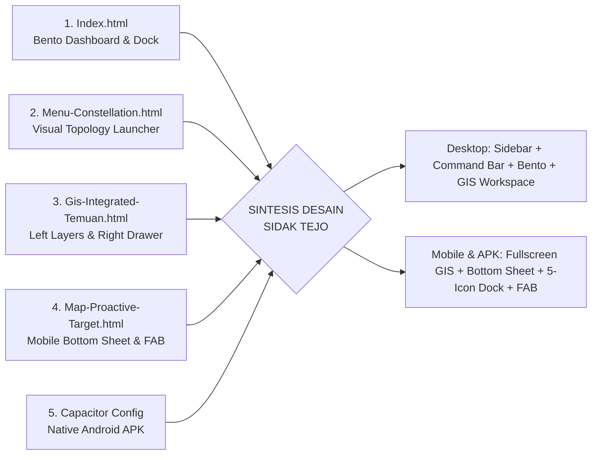
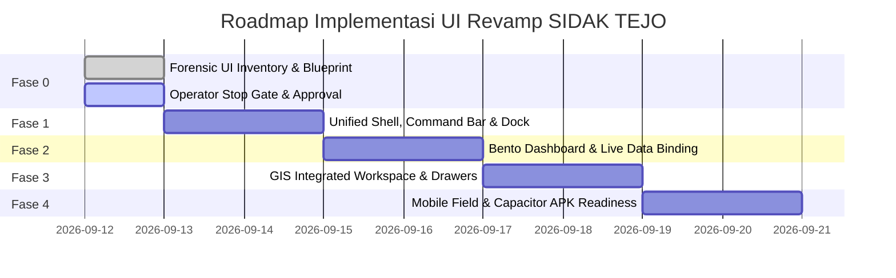

# SIDAK TEJO UI/UX REVAMP — ENTERPRISE FIELD INTELLIGENCE
## PHASE 0: FORENSIC UI INVENTORY & ARCHITECTURAL BLUEPRINT
**Document Identifier**: `UI-REVAMP-PHASE0-INVENTORY-V1.0`  
**Classification**: PLN UP3 SIDOARJO — ENTERPRISE MISSION CRITICAL  
**Status**: `SEALED & PROPOSED FOR OPERATOR APPROVAL`  
**Date**: September 12, 2026  
**Topology Engine State**: `HARD_STOP_GATE_ACTIVE` (TL-MF-02 D1.1 Provenance Sealed — Zero Topology Mutation)

---

## 1. EXECUTIVE SUMMARY & PRODUCTION BASELINE GATE

### 1.1 Status Produksi Pasca TL-MF-02 Phase D1.1
Pekerjaan backend jaringan distribusi dan rekayasa topologi otomatis telah menyelesaikan milestone terpentingnya:
- **Phase D1 (Feeder #56 BANJARAN Pilot)**: Berhasil mengeksekusi 1 batch terkendali (9 transline baru dengan Primary Key 227–235), dengan penahanan span anomali 6.13 m.
- **Phase D1.1 (Forensic Provenance Reconciliation)**: Berhasil membuktikan dengan tingkat akurasi 100% bahwa zero-collision terjadi pada seluruh domain database. Selisih koordinat geometry transline baru terhadap aset fisik induk adalah $0.0000000^\circ$ ($0.0000\text{ m}$), selisih panjang span $\le 3.5\text{ mm}$, dan 7 domain database terlindungi (`assets`, `gis_transline_proposals`, `temuan`, `temuan_materials`, `sections`, `penyulang`, `ulps`) memiliki status hash SHA-256 identik ($0$ byte termutasi).
- **Engine Lock**: Production database dan engine multi-feeder berada pada status `HARD_STOP_GATE_ACTIVE` yang terkunci secara permanen hingga audit lanjutan.

### 1.2 Mandat UI/UX Revamp: Enterprise Field Intelligence
Dengan stabilnya backend, prioritas saat ini dialihkan sepenuhnya ke **Modernisasi Antarmuka Pengguna (UI/UX Revamp)** guna menghadirkan pengalaman kelas enterprise bagi operasional lapangan PLN UP3 Sidoarjo. 

Sistem antarmuka harus melayani 4 platform target dari **satu basis kode terpadu** (CodeIgniter 4 View + Desain Modern Terpadu):
1. **Desktop Web ($\ge 992\text{px}$)**: Pusat Komando Operasional, Analisis Spasial GIS mendalam, Perencanaan Pemadaman, dan Manajemen Aset.
2. **Tablet Web ($768\text{px} - 991\text{px}$)**: Koordinasi Lapangan oleh Supervisor ULP dan Tim PDKB di kendaraan operasional.
3. **Mobile Web ($< 768\text{px}$)**: Akses cepat petugas inspeksi lapangan di smartphone melalui browser.
4. **Android APK (`site.sidaktejo.app`)**: Aplikasi Android native berbasis wrapper **Capacitor** dengan integrasi langsung ke Kamera Layar Penuh (Fullscreen Camera) dan GPS Geolocation Akurasi Tinggi.

### 1.3 Komitmen Tanpa Kompromi: Zero Topology Write
> [!CAUTION]
> **ATURAN MUTLAK PERLINDUNGAN TOPOLOGI JARINGAN**:  
> Seluruh pekerjaan UI Revamp **DILARANG KERAS** menyentuh, membuka, memodifikasi, atau mem-bypass komponen backend berikut:
> 1. Write gate dan orchestrator `TL-MF-02` (`app/Services/MultiFeederCompletionOrchestrator.php`).
> 2. Mesin inferensi transline `TranslineCompletionService.php` dan `TranslineProposalService.php`.
> 3. Logika penulisan topologi GIS pada `GisController.php` (`apiConnectTopology`, `apiDisconnectTopology`, `api-transline-*`).
> 4. Model data inti: `TranslineModel.php`, `TranslineProposalModel.php`, `AssetModel.php`, `TemuanModel.php`.
> 5. Skema database, foreign key, dan migrasi DDL pada tabel `gis_translines`, `assets`, `temuan`, `temuan_materials`.
> 
> Seluruh interaksi UI dengan data jaringan bersifat **100% READ-ONLY**.

---

## 2. FORENSIC INVENTORY MENU & NAVIGASI SAAT INI

### 2.1 Arsitektur Navigasi Eksisting (`app/Views/layouts/admin.php`)
Sistem saat ini menggunakan **Tabler UI (Bootstrap 5)** sebagai fondasi layout. Navigasi utama dikelompokkan ke dalam **5 Kategori Sidebar** dengan total 35+ tautan dan aksi:

```mermaid
graph TD
    Root[SIDAK TEJO Navigation] --> Cat1[1. CORE & ANALYTICS]
    Root --> Cat2[2. OPERASIONAL & LAPANGAN]
    Root --> Cat3[3. AI & INTELLIGENCE]
    Root --> Cat4[4. DATA & MASTER REFERENSI]
    Root --> Cat5[5. SYSTEM & LAPORAN]

    Cat1 --> M1_1[Dashboard Utama]
    Cat1 --> M1_2[Executive Analytics]
    Cat1 --> M1_3[Peta Jaringan GIS]

    Cat2 --> M2_1[Planning Inspeksi]
    Cat2 --> M2_2[Progress Inspeksi Live]
    Cat2 --> M2_3[Tugas Inspeksi Saya]
    Cat2 --> M2_4[Progress Saya]
    Cat2 --> M2_5[Riwayat Saya]
    Cat2 --> M2_6[Input Temuan]
    Cat2 --> M2_7[Data Temuan]
    Cat2 --> M2_8[Work Orders WO]
    Cat2 --> M2_9[Smart WO Center]
    Cat2 --> M2_10[Update Pekerjaan]

    Cat3 --> M3_1[SIDAK AI Copilot]
    Cat3 --> M3_2[AI Center & Predictive]
    Cat3 --> M3_3[Auto Ranking]

    Cat4 --> M4_1[Asset Health Index]
    Cat4 --> M4_2[Master Asset PLN]
    Cat4 --> M4_3[Temuan Terdekat]
    Cat4 --> M4_4[Eviden Lapangan Dropdown]
    Cat4 --> M4_5[Master Referensi Dropdown]

    Cat5 --> M5_1[Command Center ECC]
    Cat5 --> M5_2[Notifikasi Center]
    Cat5 --> M5_3[My Dashboard]
    Cat5 --> M5_4[Pusat Laporan Dropdown]
    Cat5 --> M5_5[Dokumen Center]
    Cat5 --> M5_6[Audit Trail & Evidence]
    Cat5 --> M5_7[Integration Center]
    Cat5 --> M5_8[Backup Database]
    Cat5 --> M5_9[Ganti Password]
    Cat5 --> M5_10[Logout System]
```



### 2.2 Katalog Lengkap Menu & Role Gate Permissions Matrix
Berdasarkan audit mendalam terhadap `app/Views/layouts/admin.php` dan helper `app/Helpers/app_helper.php`, berikut adalah pemetaan lengkap seluruh menu terhadap rute, controller, ikon, dan filter otorisasi peran:

| No | Kategori | Label Menu | Rute URL | Controller & Method | Ikon FA | Role Gate / Hak Akses |
|---|---|---|---|---|---|---|
| 1 | CORE | Dashboard Utama | `/dashboard` | `Dashboard::index` | `fa-gauge-high` | Semua Role |
| 2 | CORE | Executive Analytics | `/executive-dashboard` | `ExecutiveDashboardController::index` | `fa-chart-line` | Semua Role |
| 3 | CORE | Peta Jaringan (GIS) | `/gis` | `GisController::index` | `fa-map-marked-alt` | Semua Role |
| 4 | OPERASIONAL | Planning Inspeksi | `/planning` | `InspectionPlanningController::index` | `fa-clipboard-list` | Semua Role |
| 5 | OPERASIONAL | Progress Inspeksi (Live) | `/inspection-progress` | `InspectionProgressController::index` | `fa-chart-line` | Semua Role |
| 6 | OPERASIONAL | Tugas Inspeksi Saya | `/my-inspections` | `InspectionPlanningController::myInspections` | `fa-tasks` | Semua Role |
| 7 | OPERASIONAL | Progress Saya | `/my-progress` | `InspectionProgressController::myProgress` | `fa-play-circle` | Semua Role |
| 8 | OPERASIONAL | Riwayat Saya | `/my-history` | `InspectionProgressController::myHistory` | `fa-history` | Semua Role |
| 9 | OPERASIONAL | Input Temuan | `/temuan/create` | `Temuan::create` | `fa-plus-circle` | `administrator`, `admin_ulp`, `inspeksi` |
| 10 | OPERASIONAL | Data Temuan | `/temuan` | `Temuan::index` | `fa-list-check` | Semua Role |
| 11 | OPERASIONAL | Work Orders (WO) | `/work-orders` | `WorkOrderController::index` | `fa-file-invoice` | Semua Role |
| 12 | OPERASIONAL | Smart WO Center | `/smart-wo` | `SmartWoController::index` | `fa-wand-magic-sparkles` | Semua Role |
| 13 | OPERASIONAL | Update Pekerjaan | `/temuan/update-pekerjaan` | `Temuan::updatePekerjaan` | `fa-pen-to-square` | Non-`supervisor_up3` |
| 14 | AI | SIDAK AI Copilot | `/ai-copilot` | `AiCopilotController::index` | `fa-robot` | Semua Role |
| 15 | AI | AI Center & Predictive | `/ai-center` | `AiPredictiveController::index` | `fa-brain` | Semua Role |
| 16 | AI | Auto Ranking | `/ranking` | `PersonalDashboardController::ranking` | `fa-ranking-star` | Semua Role |
| 17 | DATA | Asset Health Index | `/asset-health` | `AssetHealthController::index` | `fa-heart-pulse` | Semua Role |
| 18 | DATA | Master Asset PLN | `/master-assets` | `AssetController::index` | `fa-boxes-stacked` | Semua Role |
| 19 | DATA | Temuan Terdekat | `/temuan/terdekat` | `Temuan::terdekat` | `fa-location-crosshairs` | Semua Role |
| 20 | DATA | Eviden Kubikel | `/eviden/kubikel` | `Eviden::kubikel` | `fa-folder-open` | Non-`har_row` |
| 21 | DATA | Eviden Trafo | `/eviden/trafo` | `Eviden::trafo` | `fa-bolt` | Non-`har_row` |
| 22 | DATA | Eviden Management Trafo | `/eviden/management` | `Eviden::management` | `fa-sliders` | Non-`har_row` |
| 23 | DATA | Master Gardu Induk (GI) | `/master-gi` | `GarduIndukController::index` | `fa-industry` | `administrator`, `admin_ulp` |
| 24 | DATA | Master ULP | `/ulps` | `Ulp::index` | `fa-building` | Khusus `administrator` |
| 25 | DATA | Master Penyulang | `/penyulang` | `Penyulang::index` | `fa-code-branch` | `administrator`, `admin_ulp` |
| 26 | DATA | Master Section | `/sections` | `Section::index` | `fa-bezier-curve` | `administrator`, `admin_ulp` |
| 27 | DATA | Master User | `/users` | `User::index` | `fa-users-gear` | `administrator`, `admin_ulp` |
| 28 | DATA | Import Master Data | `/import` | `Import::index` | `fa-file-excel` | `administrator`, `admin_ulp` |
| 29 | SYSTEM | Command Center (ECC) | `/ecc` | `ExecutiveCommandCenter::index` | `fa-tv` | Semua Role |
| 30 | SYSTEM | Notifikasi Center | `/notifications` | `Notification::index` | `fa-bell` | Semua Role |
| 31 | SYSTEM | My Dashboard | `/my-dashboard` | `PersonalDashboardController::index` | `fa-user-circle` | Semua Role |
| 32 | SYSTEM | Laporan Temuan | `/laporan/temuan` | `Laporan::temuan` | `fa-file-lines` | Semua Role |
| 33 | SYSTEM | Laporan Eviden | `/laporan/eviden` | `Laporan::eviden` | `fa-file-image` | Semua Role |
| 34 | SYSTEM | Laporan Management Trafo | `/laporan/management` | `Laporan::management` | `fa-file-waveform` | Semua Role |
| 35 | SYSTEM | Dokumen Center | `/documents` | `DocumentCenter::index` | `fa-file-contract` | Semua Role |
| 36 | SYSTEM | Audit Trail & Evidence | `/audit-log` | `AuditTrailController::index` | `fa-shield-halved` | Semua Role |
| 37 | SYSTEM | Integration Center | `/integration` | `IntegrationCenter::index` | `fa-network-wired` | `administrator`, `admin_pusat` |
| 38 | SYSTEM | Backup Database | `/backup-database` | `DatabaseBackup::index` | `fa-database` | `administrator`, `admin_pusat` |
| 39 | SYSTEM | Ganti Password | `/change-password` | `Auth::changePassword` | `fa-key` | Semua Role |
| 40 | SYSTEM | Logout System | `/logout` | `Auth::logout` | `fa-power-off` | Semua Role |

### 2.3 Deteksi Kritis: Anomali Duplikasi Mobile Bottom Nav
Investigasi forensik terhadap file `app/Views/layouts/admin.php` menemukan adanya **dua komponen bottom navigation yang bertabrakan di dalam DOM**:

```html
<!-- DOKUMEN DOM BARIS 1158-1195 -->
<nav class="mobile-bottom-nav" id="mobile-bottom-nav">
    <!-- Item 1: Dashboard -->
    <!-- Item 2: Temuan -->
    <!-- Item 3: Center FAB (+) Input Temuan -->
    <!-- Item 4: Eviden Lapangan -->
    <!-- Item 5: Laporan -->
</nav>

<!-- DOKUMEN DOM BARIS 2152-2176 -->
<div class="mobile-bottom-nav d-lg-none d-print-none fixed-bottom ...">
    <!-- Item 1: Home (Dashboard) -->
    <!-- Item 2: GIS (Peta Jaringan) -->
    <!-- Item 3: Center QR Scanner Button (Lingkaran Kuning Elevasi -14px) -->
    <!-- Item 4: Inspeksi (Tugas Lapangan) -->
    <!-- Item 5: Logout System (Tombol Merah) -->
</div>
```

> [!WARNING]
> **DAMPAK ANOMALI DUPLIKASI BOTTOM NAV**:
> 1. Terjadi penumpukan visual (z-index collision) atau tombol yang terpotong saat layar direntang pada resolusi mobile ($<768\text{px}$).
> 2. Versi pertama memprioritaskan alur `Dashboard -> Temuan -> FAB Input -> Eviden -> Laporan`.
> 3. Versi kedua memprioritaskan alur `Home -> GIS -> QR Scanner -> Inspeksi -> Logout`.
> 4. **Solusi Fase 1**: Menyatukan kedua navigasi bawah ini menjadi **Satu Responsive Floating Dock / Mobile Bottom Bar** yang konsisten dengan prototype `Index.html` dan `Map-Proactive-Target.html`.

### 2.4 Header Widgets & System Tray Eksisting
Header desktop (`.navbar-top-wrapper`) saat ini memiliki 8 instrumen aktif yang tidak boleh hilang:
1. **Live WIB Clock & Shift Widget**: Waktu digital server sinkron (`H:i:s WIB`) dan label shift kerja PLN (`Pagi / Sore / Malam`).
2. **Notification Center Bell Dropdown (`#bellNotifDropdown`)**: Menampilkan jumlah notifikasi belum dibaca secara realtime (`#nav-unread-count-badge`) dengan preview 5 pesan teratas.
3. **Running Ticker Motivational Announcement (`#running-announcement-text`)**: Marquee teks motivasi kerja harian yang dapat disunting langsung oleh admin.
4. **Global Smart Search (`#global-search-input`)**: Form pencarian multi-tabel dengan live autocomplete dropdown (`#global-search-dropdown`).
5. **QR Code Scanner Trigger (`#btn-qr-scan-header`)**: Tombol modal scanner kamera untuk membaca kode QR temuan atau aset di tiang/gardu.
6. **Favorite Menu Dropdown (`#favMenuToggle`)**: Daftar menu favorit yang disimpan pengguna di LocalStorage.
7. **User Profile & Role Pill**: Menampilkan nama pengguna aktif beserta label peran terverifikasi.
8. **Quick Maintenance Actions**: Tautan langsung ke modul Backup Database, Ubah Password, dan Switch Mobile View.

---

## 3. FORENSIC INVENTORY VIEWS & PAGES (88 DIREKTORI)

### 3.1 Klasifikasi Arsitektur View CodeIgniter 4
Aplikasi memiliki **88 direktori view** di dalam `app/Views/` dengan klasifikasi modular:

```
app/Views/
├── layouts/               -> admin.php (Master Shell), auth.php (Login Shell)
├── partials/              -> nav.php (Legacy standalone navbar)
├── dashboard/             -> index.php, executive.php, tv_dashboard.php, toggle.php
├── gis/                   -> index.php (Fullscreen Workspace, Leaflet, Clusters, Drawers)
├── temuan/                -> index.php, create.php, edit.php, detail.php, terdekat.php, update_pekerjaan.php, material_recap.php
├── work_orders/           -> index.php, create.php, detail.php
├── planning/              -> index.php, create.php, detail.php, my_inspections.php, shutdown_workspace.php, material_requests.php, spm_voucher.php
├── inspections/           -> index.php, start.php, guided.php
├── inspection_progress/   -> index.php, detail.php, my_progress.php, my_history.php
├── assets/                -> index.php, create.php, edit.php, detail.php, history.php, import_batches.php, debug_sql.php
├── eviden/                -> kubikel.php, trafo.php, management.php (+ create/edit masing-masing)
├── ai_copilot/            -> index.php (Voice AI & Interactive Assistant)
├── ai_predictive/         -> index.php (Predictive Maintenance Model Dashboard)
├── laporan/               -> temuan.php, eviden.php, management.php, index.php, print.php (+ templates)
├── master-gi/ulps/penyulang/sections/users -> CRUD Master Data
├── ecc/                   -> index.php (Executive Command Center Big Screen)
├── notifications/         -> index.php, templates.php, rules.php, preferences.php
├── documents/             -> index.php, create.php, detail.php, verify.php
├── audit_trail/           -> index.php, evidence.php
├── integration/           -> index.php (Enterprise Integration Gateway)
├── backup/                -> index.php (Database Backup & Restore)
└── enterprise_*/          -> 32 Modul Wave 2 Enterprise Governance Suites
```

### 3.2 Analisis Pipeline Aset Frontend & CSS
Sistem saat ini menggunakan library `App\Libraries\AssetMinifier` untuk menggabungkan file statis dari `public/`:
- **CSS Bundle**: `Tabler CSS`, `FontAwesome Free 6`, `Animate.css`, `DataTables Bootstrap 5`, `Leaflet 1.9.4`, `Select2 Bootstrap 4`, dan `custom_modern.css`.
- **JS Bundle**: `jQuery 3.x`, `Tabler JS`, `DataTables`, `SweetAlert/alert.js`, `Chart.js`, `Leaflet JS`, dan `Select2`.
- **Kondisi Offline & Lapangan**: Seluruh file CSS/JS inti telah tersimpan lokal di direktori `public/plugins/`, sehingga aplikasi dapat berjalan tanpa akses internet publik (LAN PLN / Offline Field).

---

## 4. SINTESIS 4 REFERENSI DESAIN USER-UPLOADED

Empat referensi desain interaktif yang diunggah pengguna telah dianalisis strukturnya. Desain ini bukan untuk ditelan mentah-mentah secara terpisah, melainkan digabung menjadi **satu bahasa desain yang padu**:



### 4.1 Bedah Karakteristik Setiap Prototipe
1. **`Index.html` (media_1789209367727)**:
   - **Karakter Utama**: Layout Bento Grid modern untuk Dashboard, palet warna *warm cream* (`#FFFBF8`) dan *dark glass* (`rgba(15,23,42,0.85)`), typografi `Inter` + `JetBrains Mono`.
   - **Elemen Unggulan**: Kartu KPI bergradasi (Teal, Red, Amber, Blue), Mini GIS Monitoring terintegrasi, dan floating dock bawah dengan status badge.
2. **`Sidak-Tejo-Menu-Constellation.html` / `media_1789209367692`**:
   - **Karakter Utama**: Kanvas konstelasi grafis interaktif dengan node geometris (segitiga biru untuk GIS, lingkaran berdenyut untuk Dashboard/PA1650, segitiga merah untuk WO).
   - **Peran Nyata**: Berfungsi sebagai **Visual Mission Control Launcher** (layar overview grafis sistem), **BUKAN** pengganti sidebar operasional.
3. **`Gis-Integrated-Temuan-Nempel.html` (media_1789209367710)**:
   - **Karakter Utama**: Integrasi aset GIS mendalam. Memiliki kontrol layer sisi kiri (JTM, Gardu, Trafo, Temuan) dan laci informasi aset sisi kanan (*Right Asset Context Drawer*).
   - **Fitur Kunci**: Menyajikan "Temuan Nempel" (daftar temuan yang tertaut otomatis pada tiang/gardu yang dipilih), rincian BOM material JTM, dan tombol cepat "Buat Temuan dari Aset Ini".
4. **`Map-Proactive-Target.html`**:
   - **Karakter Utama**: Pengalaman lapangan mobile-first. Kanvas peta satu layar penuh tanpa header berat, indikator target proaktif, dan bottom sheet geser ke atas (*swipe-up drawer*) untuk eksekusi form temuan cepat.
   - **Touch Ergonomics**: Semua tombol dan area sentuh berukuran minimal $44\text{px} \times 44\text{px}$.

### 4.2 Rekonsiliasi Forensik: Angka Mockup vs Live Data Binding
> [!IMPORTANT]
> **TEMUAN FORENSIK ANGKA MOCKUP**:  
> Di dalam file prototype terdapat angka-angka seperti:
> - `596` (Jumlah Temuan)
> - `137` (Emergency)
> - `411` (High Priority)
> - `48` (Medium)
> - `495` (Belum Selesai)
> - `1` (WO Aktif)
> - `89` (Sudah Selesai)
> - `72%` / `18/25` (Target Harian)
> - `PA1650` (Permata Alam)
>
> **FAKTA**: Angka-angka tersebut **BUKAN hardcoded angka baru**, melainkan merupakan *snapshot* langsung dari variabel `$stats`, `$woStats`, dan `$canInput` yang ada di controller `app/Controllers/Dashboard.php` dan `app/Views/dashboard/index.php`.  
> **KOMITMEN PRODUKSI**: Pada implementasi UI Revamp, komponen antarmuka baru **wajib terikat 100% (data-bound)** ke variabel PHP dinamis dan query MariaDB produksi yang sudah ada, tanpa ada angka statis tiruan.

---

## 5. BLUEPRINT ARSITEKTUR & INTEGRASI MULTI-PLATFORM

### 5.1 Arsitektur Antarmuka Desktop Web ($\ge 992\text{px}$)
1. **Primary Operational Navigation (Left Sidebar)**:
   - Sidebar Tabler tetap menjadi navigasi utama agar staf dan operator yang terbiasa dengan 35+ menu operasional tidak mengalami disorientasi kerja.
   - Dilengkapi mode lipat (*collapsed mode* 68px) untuk memperluas area kerja GIS dan tabel data.
2. **Top AI Command Bar**:
   - Baris pencarian mengambang di atas (`⌘K` shortcut) dengan input terpadu: "Tanya AI atau cari PA1656, gardu, temuan...".
   - Dilengkapi Quick Action Pill: Switch Theme (Dark/Warm Light), Notifikasi, dan Avatar Profil.
3. **Constellation Mission Control Mode**:
   - Disediakan tombol toggle untuk berpindah dari Tampilan Dashboard Tabel/Bento ke **Tampilan Kanvas Konstelasi** sebagai visual launcher interaktif.
4. **GIS Workspace Desktop**:
   - Panel kontrol layer mengambang di sisi kiri peta.
   - Kanvas Leaflet interaktif di bagian tengah.
   - Laci Konteks Aset (*Right Context Drawer*) selebar 380px–420px di sisi kanan saat aset tiang/gardu diklik.

### 5.2 Arsitektur Antarmuka Mobile Web & Android APK ($< 768\text{px}$)
1. **Edge-to-Edge Fullscreen Viewport**:
   - Memaksimalkan area layar HP dengan menghilangkan sidebar samping desktop.
   - Mendukung safe-area insets untuk notch kamera dan home indicator Android:
     ```css
     padding-top: max(12px, env(safe-area-inset-top));
     padding-bottom: max(16px, env(safe-area-inset-bottom));
     ```
2. **Unified Mobile Bottom Dock**:
   - Menggantikan 2 bottom nav lama dengan **1 Bottom Dock Modern Berisi 5 Slot Utama**:
     1. `🏠 Home` (Dashboard Bento)
     2. `🗺️ GIS` (Peta Jaringan Fullscreen)
     3. `📋 Tugas` (Planning & Inspeksi Saya dengan Badge Count)
     4. `＋ Input` (Center Floating Action Button / FAB terangkat untuk Input Temuan Cepat)
     5. `🤖 AI / More` (Menu Konstelasi, Dokumen, Profil)
3. **Mobile Bottom Sheet Aset**:
   - Saat aset tiang atau anomali disentuh di peta mobile, muncul Bottom Sheet setinggi 40%–85% layar dengan *drag handle* halus.
   - Menampilkan identitas aset (e.g. `PA1650 • Penyulang PERMATA ALAM`), status kelayakan, temuan tertaut, dan tombol aksi "Isi Form Temuan" dengan tinggi tombol $48\text{px}$.

### 5.3 Blueprint Integrasi Android APK (Capacitor `site.sidaktejo.app`)
Berdasarkan artefak konfigurasi `Capacitor-Config.json`:
- **App ID**: `site.sidaktejo.app`
- **App Name**: `SIDAK TEJO`
- **Server Scheme**: `https`
- **Native Plugins**:
  - `Camera`: Dikonfigurasi dengan `presentationStyle: "fullscreen"` untuk pengambilan foto temuan lapangan resolusi penuh dengan kompresi otomatis client-side.
  - `Geolocation`: Terhubung langsung ke GPS hardware HP untuk menangkap koordinat lintang/bujur (Latitude/Longitude) akurat seketika di bawah tiang listrik, dilengkapi pendeteksi akurasi horizontal ($< 5\text{ m}$).
- **Resiliensi Jaringan Lapangan**:
  - Service Worker (`sw.js`) untuk menyimpan cache aset statis CSS, JS, font, dan tile peta area aktif.
  - Banner peringatan offline non-intrusif jika koneksi data seluler terputus di pelosok jaringan.

---

## 6. BATASAN FILE: MODIFIKASI DIPERBOLEHKAN VS DILARANG KERAS

### 6.1 Daftar File yang Diizinkan untuk Dimodifikasi (Phase 1–4)
Hanya file presentasi, layout, CSS, JS, dan controller pembantu antarmuka yang boleh disentuh:

| Layer | File / Direktori | Rencana Perubahan |
|---|---|---|
| Master Layout | `app/Views/layouts/admin.php` | Modernisasi shell antarmuka, penyatuan bottom dock mobile, injeksi AI Command Bar |
| Dashboard View | `app/Views/dashboard/index.php` | Redesain Bento KPI Card modern, integrasi live chart, data binding dinamis |
| GIS View | `app/Views/gis/index.php` | Layout layer kiri mengambang, laci konteks aset kanan, bottom sheet mobile |
| Asset CSS | `public/dist/css/custom_modern.css` | Penambahan styling Glassmorphism, Bento Grid, Floating Dock, Animasi Pulse |
| Helper | `app/Helpers/app_helper.php` | Penambahan fungsi helper rendering komponen antarmuka (jika diperlukan) |
| Views Penunjang | `app/Views/temuan/create.php`, `app/Views/temuan/detail.php` | Penyesuaian responsivitas mobile & ukuran touch target |
| Mobile Config | `capacitor.config.json` | Konfigurasi pembungkus aplikasi Android native |

### 6.2 Daftar File yang DILARANG KERAS Dimodifikasi (Frozen / Immutable)
Komponen backend, topologi, dan logika database berikut berada di bawah pengawasan ketat dan **DILARANG DIRUBAH**:

```
[STRICTLY FORBIDDEN FROM MODIFICATION]
├── app/Services/MultiFeederCompletionOrchestrator.php  (TL-MF-02 Orchestrator Engine)
├── app/Services/TranslineCompletionService.php         (Transline Inference Engine)
├── app/Services/TranslineProposalService.php           (Proposal Evaluation Engine)
├── app/Controllers/GisController.php [Topology Write]  (Metode: apiConnectTopology, apiDisconnectTopology, api-transline-*)
├── app/Models/TranslineModel.php                       (gis_translines Data Model)
├── app/Models/TranslineProposalModel.php               (gis_transline_proposals Model)
├── app/Models/AssetModel.php                           (assets Table Model)
├── app/Models/TemuanModel.php                          (temuan Table Model)
├── app/Models/TemuanMaterialModel.php                  (temuan_materials Table Model)
└── app/Database/Migrations/*                           (Seluruh file migrasi database)
```

---

## 7. ANALISIS RISIKO & STRATEGI MITIGASI

| ID | Risiko Potensial | Tingkat Dampak | Strategi Mitigasi Teruji |
|---|---|---|---|
| **R-01** | Tabrakan CSS antara Tabler Bootstrap 5 dan utility Tailwind | Sedang | Hindari memuat CDN Tailwind global secara mentah ke `admin.php`. Gunakan teknik scoped custom CSS di `custom_modern.css` yang mengadopsi variabel warna Tabler (`--tblr-primary`, dll). |
| **R-02** | Gangguan tampilan peta Leaflet (Gray Tiles) saat Drawer dibuka | Tinggi | Pasang event listener otomatis: setiap kali laci kanan dibuka atau bottom sheet digeser, panggil `window.map.invalidateSize()` dengan delay 250ms. |
| **R-03** | Kehilangan akses menu bagi peran tertentu saat sidebar disederhanakan | Kritis | Terapkan audit role gate ketat. Seluruh 35 menu tetap dapat diakses melalui Sidebar Lipat atau Command Bar Launcher (`⌘K`). |
| **R-04** | Duplikasi event listener pada Bottom Dock Mobile baru | Sedang | Bersihkan secara tuntas elemen lama di baris 1158 dan 2152 `admin.php`, gantikan dengan single DOM container yang memiliki id unik `#sidak-mobile-dock`. |
| **R-05** | Form temuan terpotong keyboard virtual di Android APK | Tinggi | Terapkan viewport meta `interactive-widget=resizes-content` dan CSS `scroll-padding-bottom` pada elemen form. |

---

## 8. ROADMAP IMPLEMENTASI (FASE 1 HINGGA FASE 4)



### Rincian Rencana Kerja Bertahap:
- **FASE 1: Unified Design System & Shell Architecture**
  - Membersihkan duplikasi bottom navigation di `admin.php`.
  - Membangun AI Command Bar (`⌘K` modal search) pada header.
  - Membangun Unified Floating Dock / Mobile Bottom Bar dengan Center FAB.
  - Menyelaraskan palet warna warm light (`#FFFBF8`) dan enterprise dark tosca (`#004D4F`).
- **FASE 2: Bento Dashboard & Live Production Data Binding**
  - Mengonversi kartu metrik dashboard lama menjadi Bento KPI modern bergradasi.
  - Mengikat angka-angka KPI secara dinamis ke variabel live `$stats`, `$woStats`, dan target harian.
  - Menghadirkan Mini GIS Card dengan status koneksi live.
- **FASE 3: Integrated GIS Workspace & Asset Context Drawer**
  - Menata ulang tata letak GIS: Kontrol layer kiri mengambang, Peta Leaflet tengah, Laci informasi aset kanan.
  - Mengintegrasikan panel "Temuan Nempel" yang menampilkan anomali per tiang/gardu.
  - Menambahkan Bottom Sheet interaktif untuk tampilan mobile.
- **FASE 4: Mobile Field Optimization & Android Capacitor APK Readiness**
  - Memastikan seluruh touch target $\ge 44\text{px}$.
  - Menguji integrasi Capacitor Camera & Geolocation API.
  - Validasi safe-area insets pada layar bertakik (punch hole / notch).
  - Verifikasi ketahanan offline melalui Service Worker.

---

## 9. STOP GATE & PERMOHONAN PERSETUJUAN OPERATOR

> [!IMPORTANT]
> **STATUS STOP GATE FASE 0**:  
> Seluruh inventarisasi forensik UI, pemetaan menu, deteksi konflik bottom-nav, sintesis 4 prototipe, batasan file, dan mitigasi risiko telah **SELESAI DOKUMENTASIKAN**.  
> **TIDAK ADA PERUBAHAN KODE ATAU MUTASI UI YANG DILAKUKAN PADA FASE 0 INI**.
>
> **TINDAKAN BERIKUTNYA MEMBUTUHKAN PERSETUJUAN ANDA**:  
> Mohon berikan review dan persetujuan (GO / REVISI) terhadap dokumen Fase 0 ini untuk melanjutkan ke **FASE 1 (Unified Design System, Layout Shell & Responsive Dock)**.
